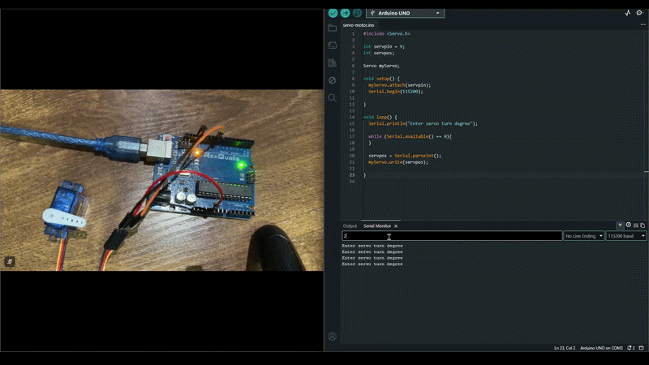
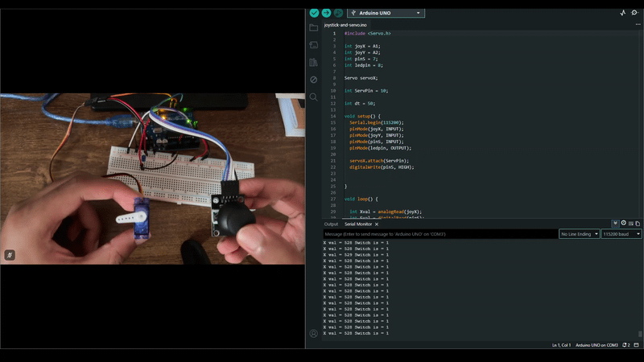

# Servo Motor

## Simple Servo Program

### Description
A servo motor is an incredibly useful component because it can change its angle accurately. The servo provided in the Arduino kit has limited functionality, where it can only turn from 0 degrees to about 165 degrees.

The program asks for an angle to be input and turns the servo motor accordingly

### GIF

## Servo motor controlled by joystick

### Description
This project further proves the versatility of a servo motor as it can be controlled by a joystick. By simply translating the joystick values to the angle on the servo motor, this can be achieved.

My Arduino kit only came with one servo motor, but a joystick can manipulate more than one motor as it has two axis. So connecting two servo motors together can achieve full range of motion and many devices like a distance sensor, a camera or a pointer can be attached.

### GIF

