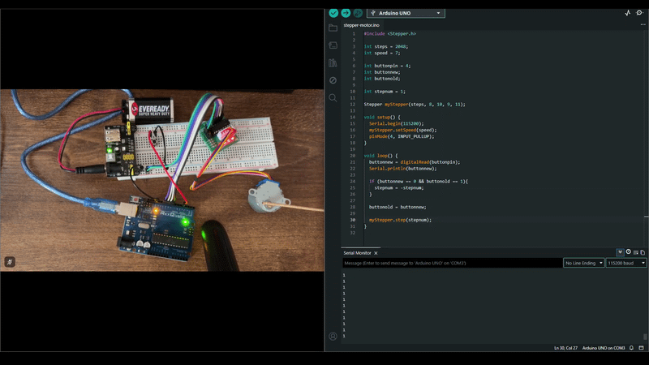

# Stepper Motor

## What is a stepper motor?
The stepper motor used in this project is a 28BYJ-48. It basically acts as any normal motor but does it in steps - not at once. This motor has 2048 steps per revolution and it can only spin at a slow speed which is why I used 7 RPM. 

## How does the code work?
The program basically reverses the direction of the stepper motor at the click of a button. All it does is allow the stepper motor to turn one step every loop iteration and since the loop has no delay it appears to spin smoothly. If the button is pressed, it changes the step value from +1 to -1 and vice versa which simply reverses the direction every time.

## GIF

