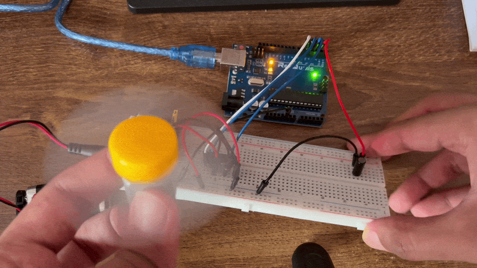
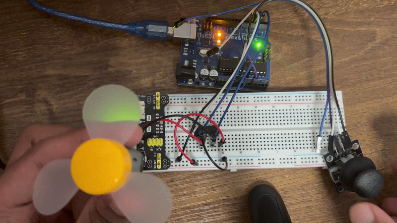

# DC Motor

## Tilt switch
A tilt switch changes its value by simply tilting it. There is a moving part inside the switch that leaves a contact producing a value of 0. in an upright position, it is in contact and has a value of 1. I hooked up a circuit where if the switch is tilted, a dc motor stops running.

## GIF

## Joystick
I used a joystick to control the speed of the dc motor. This was done by creating an equation to map the joystick value to the speed of the motor which can be seen in the code.

## GIF

