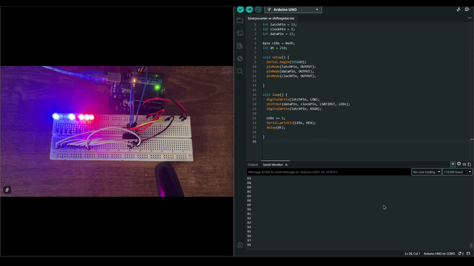
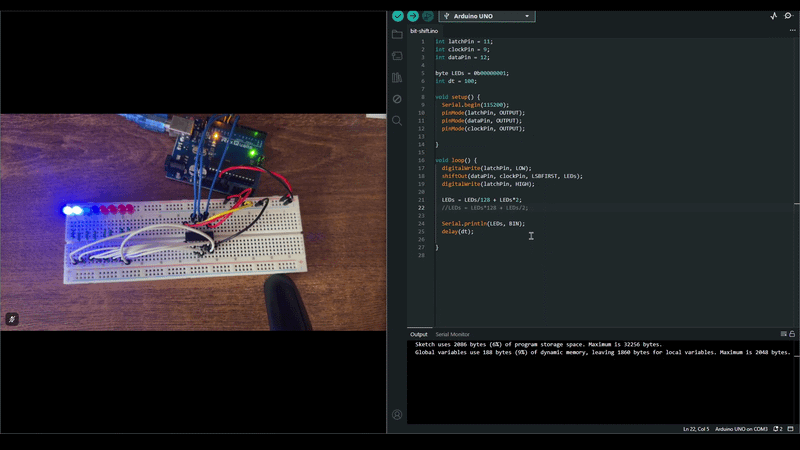

# Shift register

## 8 bit counter

### Description
This program is different from the initial binary counter I made involving 5 bits. The shift register allows for an increased simplicity in the code as the individual LEDs are connected to their own respective pins. So, they each represent a bit and they can automatically increment.

Since 8 bit numbers are very big, I used a small delay time which is why the LEDs are counting very fast.

### GIF

## Bit shift

### Description
In a binary number, bits can shift by simply multiplying or dividing the number by 2. but depending on what you are doing the most or least significant bits will be lost. This is why circular shift exists here the bits that would otherwise be lost are simply made to appear from the other side. 

When shifting to the left, the 8-bit binary number is first divided by 128 and then added to the number multiplied by 2. On the other hand, when shifting to the right, the number is multiplied by 128 and then added to the number divided by 2.

### Why is this done?
Multiplying and dividing by 2 moves the bits while multiplying or dividing by 128 saves the most or least significant bit and puts it back in the answer. For instance: 

10010110 × 2      → 00101100  (the most significant bit is lost)
10010110 ÷ 10000000 (128)   → 00000001   (the bit is saved)
00101100 + 00000001 = 00101101  (and it is added back)

### GIF

