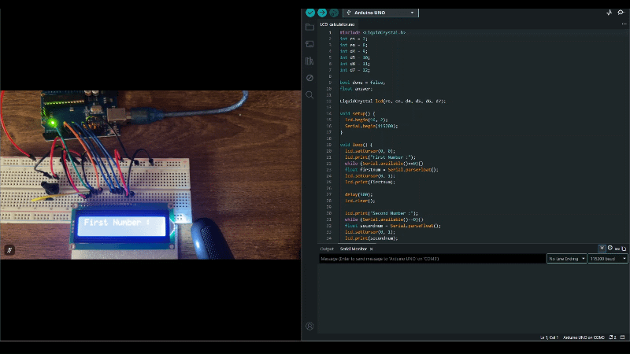
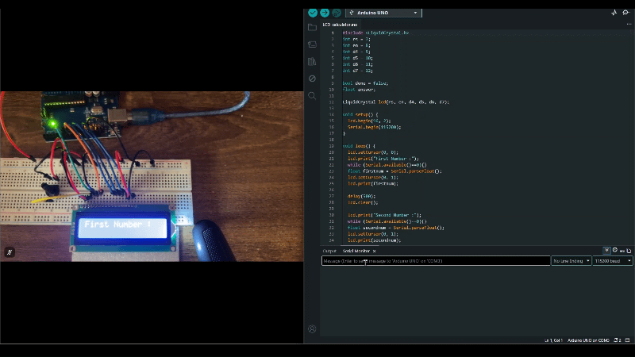

# LCD Display

## How it works
The LCD Display I used is a 16x2 display why basically can show 16 characters per line and it has two lines. You can set the cursor position to anywhere on the screen giving this component an array of possibilities.

The LCD needs a potentiometer as it controls the contrast of the display. The output is visible best at a particular contrast which I found by turning the potentiometer slowly.

## Project: Calculator

### Description
Making a calculator does not involve anything too crazy. It is just a bunch of if statements checking for operators and variables handling the calculations. However, the challenge arises in the display changing every time some value is input. Initially my display was showing all sorts of things until I realised it doesn't auto clear and I have to manually use lcd.clear in the right place. I have included some error displays as well.

### GIF of calculation

### GIF of errors

