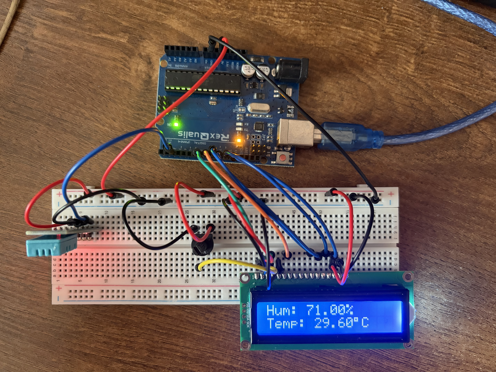

# DHT11

## Description
The DHT11 is a temperature and humidity sensor. To get the values from the sensor, a library and special commands need to be used as showed in the code. The sensor gives the temperature in both Celsius and Fahrenheit.

I used the lcd display to show the output instead of the serial monitor. This way if you hook up the Arduino to a battery, you will be able to carry the circuit around and measure different rooms easily.

## Here is an image of the circuit and the temperature and humidity in my room.

