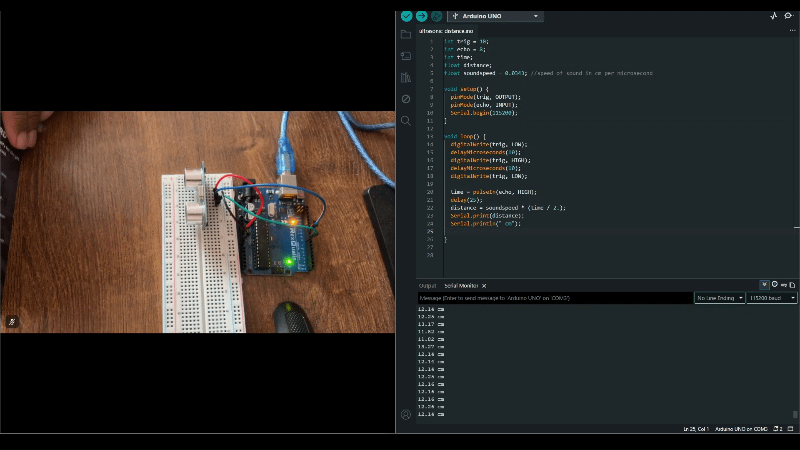
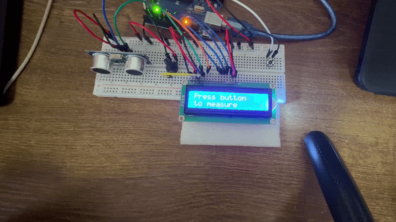

# Ultrasonic Sensor

## How does it work?
It works by firing a beam of ultrasonic waves and once they hit a target they bounce back and are detected. The time between the firing and detecting is recorded by the sensor. This can be sued to find values like distance.

## Distance detector
The speed of sound in air is about 343 m/s or 0.0343 cm/s. This crucial value can be used to find the distance of an object from the sensor. Since the sensor can give the time, distance is simply speed * time. But it is not that simple. The time value is the time taken for the beam to travel to the object and back so distance must be divided by 2.

I did two versions of the project. One has a button and the other gives live changes. The one with the go button may be more accurate as I take into account 50 readings at a time and find the average which increases accuracy greatly.

## GIF of live readings

## GIF of button

